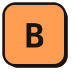

<p align="center"></p>

# bytemerge

[](https://github.com/Gulliby-development/bytemerge/actions/workflows/ci.yml) [](LICENSE)

bytemerge is a small Java command-line byte-pair encoding (BPE) tokenizer. It
learns deterministic merges from plain text and lets you inspect, encode,
decode, count, and measure them. Its byte-level rules are explicit, so the
program is useful for studying tokenizers, building repeatable evaluation
fixtures, and using a tiny tokenizer in scripts or CI without a framework or
external vocabulary.

## Requirements and build

Use Java 21 and Maven. The application uses only the Java standard library at
runtime; JUnit is used only for tests.

```sh
mvn -B verify
java -cp target/classes io.github.gulliby.bytemerge.Main COMMAND ...
```

The second line is the exact classpath invocation; replace `COMMAND ...` with
one of the command forms below. Input text is read from standard input for
count, train, encode, decode, and stats. Vocab does not use the input, although
Main reads stdin for every syntactically valid invocation, including vocab.
Handlers that require a model validate it before processing stdin content; Main has already read stdin for a syntactically valid invocation.

## Commands

```text
usage: bytemerge count [--top N]
       bytemerge vocab --model MODEL
       bytemerge train [--merges N] [--min-count K]
       bytemerge encode --model MODEL [--ids]
       bytemerge decode --model MODEL
       bytemerge stats --model MODEL
```

- `count [--top N]` lists distinct words by descending count, then unsigned
  bytewise order. N defaults to all words; if supplied it is 1–100000.
- `vocab --model MODEL` lists each merge with its id and operand/result
  display forms.
- `train [--merges N] [--min-count K]` learns a model. N defaults to 10 and
  ranges from 0–1000; K defaults to 2 and ranges from 1–1000000.
- `encode --model MODEL [--ids]` encodes each word as display tokens, or as
  decimal token ids with `--ids`.
- `decode --model MODEL` decodes whitespace-separated decimal token ids.
- `stats --model MODEL` reports word, byte, token, unique-token counts and a
  compression ratio.
- `help`, `-h`, or `--help` as the first argument prints the usage; it
  ignores following arguments. `--version` similarly prints
  `bytemerge 0.1.0`. With no arguments, usage is written to stderr and status
  2 is returned.

Options can appear in any order. Parsing is left-to-right: the first argument
that violates a rule determines the diagnostic. Numeric options accept one to
seven unsigned decimal digits and must also be in their stated range.
Duplicate options are rejected. Model text is the value of `--model`, not a
path; a model option with no next argument is an error, while an empty string
is a value that will fail model parsing.

## Connected example

The corpus in this example is the exact UTF-8 text `ab ab ab ab cd cd cd cd`
with no final newline. Its eight words are `ab`, three occurrences of
` ab`, and four occurrences of ` cd`. The model below is the actual
output of training this corpus with the default settings. Model lines shown in code blocks are
separated by real LF bytes; the final LF is present.

Count the corpus:

```text
$ printf %s 'ab ab ab ab cd cd cd cd' | java -cp target/classes io.github.gulliby.bytemerge.Main count
4 \scd
3 \sab
1 ab
```

Train it; stdout is the model used by all following examples:

```text
$ printf %s 'ab ab ab ab cd cd cd cd' | java -cp target/classes io.github.gulliby.bytemerge.Main train
bytemerge-model 1
\s c
a b
\sc d
\s ab
```

Inspect merges:

```text
$ java -cp target/classes io.github.gulliby.bytemerge.Main vocab --model "$(< model.txt)"
256 \s c \sc
257 a b ab
258 \sc d \scd
259 \s ab \sab
```

The preceding command assumes `model.txt` contains exactly the training output.
Encode the same corpus, once with display forms and once with ids:

```text
$ printf %s 'ab ab ab ab cd cd cd cd' | java -cp target/classes io.github.gulliby.bytemerge.Main encode --model "$(< model.txt)"
ab
\sab
\sab
\sab
\scd
\scd
\scd
\scd
$ printf %s 'ab ab ab ab cd cd cd cd' | java -cp target/classes io.github.gulliby.bytemerge.Main encode --model "$(< model.txt)" --ids
257
259
259
259
258
258
258
258
```

Decode those ids (the decoded text has no added newline):

```text
$ printf %s '257 259 259 259 258 258 258 258' | java -cp target/classes io.github.gulliby.bytemerge.Main decode --model "$(< model.txt)"
ab ab ab ab cd cd cd cd
```

Measure the original corpus:

```text
$ printf %s 'ab ab ab ab cd cd cd cd' | java -cp target/classes io.github.gulliby.bytemerge.Main stats --model "$(< model.txt)"
words 8
bytes 23
tokens 8
unique 3
ratio 2.88
```

## Words, display forms, and models

All operations use the text's UTF-8 bytes. Whitespace is exactly space, tab,
LF, and CR. Each non-whitespace run is a word and takes the single whitespace
byte immediately before it, when present. Earlier bytes in a whitespace run
are their own word: `a  b` splits into `a`, ` `, and ` b`. Trailing
whitespace is one word; empty input has no words. Count breaks ties by
unsigned byte order (a prefix sorts first).

Display forms make byte strings unambiguous: backslash is `\\`; space,
LF, CR, and tab are `\s`, `\n`, `\r`, and `\t`; printable ASCII
`!` through `~` (except backslash) is literal; every other byte is
`\xHH`, using two lowercase hexadecimal digits. For example, UTF-8 `é`
is displayed as `\xc3\xa9`. Display escapes are notation, not the actual
bytes in the text.

A model starts with the exact header `bytemerge-model 1`, followed by zero or
more lines `LEFT RIGHT` with exactly one separating space. Each operand is a
display form. Ids 0–255 are individual byte values; merge line k defines id
256+k as LEFT bytes followed by RIGHT bytes. Operands must already exist and a
joined token may not duplicate any existing token. Lines are LF-separated;
the last LF is optional. CR is ordinary line data, not a line ending. A
header-only model is valid.

Training counts distinct words with their frequencies. At each step it counts
every adjacent pair position (including overlapping positions such as the two
`a a` pairs in `aaa`), weighted by word frequency, and excludes pairs whose
joined bytes already exist as a token. It chooses the greatest total, breaking
ties by smaller left id and then smaller right id. It stops at the merge limit,
when no pair remains, or when the best count is below `--min-count`. Applying
a merge scans left-to-right and replaces non-overlapping occurrences.

Encoding starts each word as bytes and applies each model merge once in order,
also using left-to-right non-overlapping replacements. It outputs one line per
word; an empty input outputs nothing. Decode accepts one to seven decimal
digits per id, separated by any amount of space, tab, LF, or CR. It concatenates
the token bytes, strictly validates the result as UTF-8, and writes exactly
that text without adding a newline. No ids decode to empty text. Stats reports
the number of words, UTF-8 bytes, encoded tokens, distinct token ids, and
bytes-per-token ratio rounded half up to two decimal places; it reports
`ratio 0.00` when there are no tokens.

## Diagnostics and streams

Successful commands write only their result to stdout and return status 0.
Failures write no stdout and one LF-terminated `bytemerge: MESSAGE` line to
stderr. Command-line errors return status 2; invalid model text and data errors
return status 1. The implementation's unexpected internal-error fallback is
`bytemerge: internal error` (status 1).

Command-line diagnostic messages are:

- `unknown command WORD`, `unexpected argument WORD`, and
  `unknown option WORD`.
- `OPTION given twice`.
- `--top needs an integer from 1 to 100000`,
  `--merges needs an integer from 0 to 1000`, and
  `--min-count needs an integer from 1 to 1000000`.
- `--model needs a value` and `COMMAND needs --model MODEL`.

Model errors use `bad model: line N: REASON`, where the reason is
`expected "bytemerge-model 1"`, `expected two tokens`,
`bad token "FIELD"`, `unknown token "FIELD"`, or `duplicate token`.
The first applicable error is reported in line order; on a merge line, the
left field's syntax and lookup are checked before the right field's syntax and
lookup.

Data errors are `bad id "TOKEN"`, `unknown id N`, and
`decoded bytes are not valid UTF-8`. The first invalid/unknown id from the
left is reported. A decode that yields invalid UTF-8 emits no partial output.
All error messages are prefixed with `bytemerge: ` and followed by LF on
stderr.

## Cross-platform use

The program encodes stdin and stdout as UTF-8 and constructs result lines with
LF, so command output bytes are platform-independent. Keep input files as
UTF-8 without a byte-order mark (BOM); avoid shell conversions that rewrite
newlines when exact bytes matter. Use file redirection for corpus input when
possible (for example, `java ... < corpus.txt`) rather than a shell pipeline
that may transcode text.

A model argument must contain actual LF characters, not the two literal
characters backslash and `n`, and it is not a filename. POSIX shells can pass
the contents of a model file as one argument with:

```sh
java -cp target/classes io.github.gulliby.bytemerge.Main vocab --model "$(cat model.txt)"
```

For byte-exact input and output on Windows, use Windows PowerShell 7
(`pwsh`) and .NET byte streams rather than text pipelines or shell output
redirection. This helper writes stdin bytes directly and saves stdout bytes
without decoding, BOM insertion, or newline conversion:

```powershell
$utf8 = [Text.UTF8Encoding]::new($false)
[IO.File]::WriteAllBytes("corpus.txt", $utf8.GetBytes("ab ab ab ab cd cd cd cd"))

function Invoke-Bytemerge([string[]] $CliArgs, [byte[]] $InputBytes, [string] $OutputPath) {
    $start = [Diagnostics.ProcessStartInfo]::new("java")
    $start.ArgumentList.Add("-cp")
    $start.ArgumentList.Add("target/classes")
    $start.ArgumentList.Add("io.github.gulliby.bytemerge.Main")
    foreach ($arg in $CliArgs) { $start.ArgumentList.Add($arg) }
    $start.UseShellExecute = $false
    $start.RedirectStandardInput = $true
    $start.RedirectStandardOutput = $true
    $start.RedirectStandardError = $true
    $process = [Diagnostics.Process]::new()
    $process.StartInfo = $start
    [void] $process.Start()
    $process.StandardInput.BaseStream.Write($InputBytes, 0, $InputBytes.Length)
    $process.StandardInput.BaseStream.Close()
    $output = [IO.MemoryStream]::new()
    $process.StandardOutput.BaseStream.CopyTo($output)
    $errors = [IO.MemoryStream]::new()
    $process.StandardError.BaseStream.CopyTo($errors)
    $process.WaitForExit()
    [IO.File]::WriteAllBytes($OutputPath, $output.ToArray())
    if ($process.ExitCode -ne 0) {
        throw $utf8.GetString($errors.ToArray())
    }
    return ,$output.ToArray()
}

$corpus = [IO.File]::ReadAllBytes("corpus.txt")
$modelBytes = Invoke-Bytemerge @("train") $corpus "model.txt"
$model = $utf8.GetString($modelBytes) # Contains actual LF characters.
[void] (Invoke-Bytemerge @("count") $corpus "count.txt")
[void] (Invoke-Bytemerge @("vocab", "--model", $model) [byte[]]@() "vocab.txt")
[void] (Invoke-Bytemerge @("encode", "--model", $model) $corpus "tokens.txt")
[void] (Invoke-Bytemerge @("encode", "--model", $model, "--ids") $corpus "ids.txt")
$idBytes = $utf8.GetBytes("257 259 259 259 258 258 258 258")
[void] (Invoke-Bytemerge @("decode", "--model", $model) $idBytes "decoded.txt")
[void] (Invoke-Bytemerge @("stats", "--model", $model) $corpus "stats.txt")
```

The corpus file above has no BOM and no final newline; the model is captured
verbatim with its real LF separators and supplied as one argument through
`ProcessStartInfo.ArgumentList`. Output files contain the exact stdout bytes.
Use UTF-8 files without BOM and LF separators for models. Do not use
`--model model.txt`: that passes the filename as model text.

## Development

The implementation is organized around shared APIs: `Api` contains command
options, results, handlers, and failures; `Registry` lists commands;
`Cli` parses and dispatches; `Main` alone accesses process streams.
`Text` owns byte-oriented word splitting and display conversion, `Model`
validates and exposes merge rules, and `Bpe` applies them. Command adapters
implement counting, vocabulary display, training, encoding, decoding, and
statistics.

Run `mvn -B verify` before changes. The tests are literal rows through
`Cli.run` and `Cli.readsStdin`, organized in thirteen files: CliTest (10),
OptionsTest (15), PretokTest (14), DisplayTest (11), ModelTest (19),
TrainBasicTest (12), TrainTiesTest (12), TrainLimitsTest (12), EncodeTest
(12), EncodeIdsTest (12), EncodeOrderTest (10), DecodeTest (13), and StatsTest
(12). Keep row expectations exact and add no platform-specific assumptions.
The project targets Java 21, UTF-8 source encoding, and standard-library-only
runtime dependencies.

See [LICENSE](LICENSE) for the MIT license.

---

Built with [BAKED](https://github.com/Gulliby-development/baked), an open-source coding agent (bench round R83).
